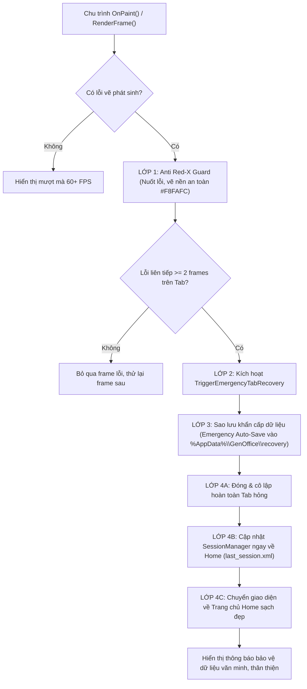

# ZENQ OFFICE - TÀI LIỆU HỆ THỐNG MÃ LỖI & CƠ CHẾ TỰ BẢO VỆ PHỤC HỒI (SELF-HEALING ARCHITECTURE)

> **Tài liệu kỹ thuật nội bộ & Sổ tay tra cứu mã sự cố**  
> *Áp dụng từ phiên bản ZenQ Office Suite 2026*

---

## 1. TỔNG QUAN VỀ HIỆN TƯỢNG "DẤU CHÉO ĐỎ" (RED-X) VÀ CƠ CHẾ BẢO VỆ

### 1.1. Bản chất của "Dấu chéo đỏ" (Red X) trong Windows Forms
Trong nền tảng đồ họa Windows Forms của .NET, khi phương thức vẽ giao diện `OnPaint()` hoặc thông điệp `WM_PAINT` ném ra một ngoại lệ không được bắt (`Unhandled Exception`), lớp hạ tầng `System.Windows.Forms.Control.PaintWithErrorHandling` sẽ bắt giữ sự cố này.

Hậu quả là:
1. Windows Forms đánh dấu Control/Form đó là **bị hỏng trạng thái vẽ vĩnh viễn (Corrupted Graphics State)**.
2. Windows Forms tự động vẽ đè một **hình chữ nhật màu trắng với một dấu gạch chéo đỏ lớn (Red Cross / Red X)** từ góc này sang góc kia trên toàn bộ màn hình.
3. Control/Form đó sẽ **ngừng hoàn toàn việc nhận thông điệp vẽ tiếp theo**. Mọi thao tác chuột, bàn phím và cuộn trang đều bị vô hiệu hóa.

### 1.2. Vấn đề "Kẹt tab lỗi khi mở lại ứng dụng" (Session Recovery Loop)
Nếu ứng dụng có tính năng khôi phục phiên làm việc (Session Restore):
* Khi tab bị lỗi kết xuất, thông tin tab active vẫn được lưu trong `last_session.xml`.
* Người dùng tắt ứng dụng và mở lại, `SessionManager` tự động nạp lại đúng tab đang hỏng đó.
* Vừa nạp xong, `OnPaint()` lại tiếp tục gặp lỗi vẽ -> Lại xuất hiện Dấu chéo đỏ.
* **Hậu quả:** Người dùng bị kẹt vĩnh viễn trong vòng lặp crash và không thể sử dụng được bất kỳ tính năng nào của ứng dụng.

---

## 2. KIẾN TRÚC TỰ BẢO VỆ 4 LỚP CỦA ZENQ OFFICE (SELF-HEALING ENGINE)

Để giải quyết triệt để tình trạng trên, ZenQ Office tích hợp cơ chế tự phục hồi khẩn cấp 4 lớp:

### Chi tiết 4 lớp bảo vệ:

1. **Lớp 1 - Anti Red-X Paint Guard (`AppForm.OnPaint`):**
   * Toàn bộ mã nguồn `OnPaint()` được bao bọc trong khối bảo vệ tối cao. Tuyệt đối không để bất kỳ lỗi nào lọt ra ngoài tầng WinForms runtime.
   * Nếu xảy ra lỗi nghiêm trọng, ứng dụng lập tức phủ một lớp nền mềm mại màu Slate-50 (`#F8FAFC`), **triệt tiêu hoàn toàn dấu chéo đỏ**.

2. **Lớp 2 - Bộ đếm lỗi liên tiếp (`_tabPaintErrorCount`):**
   * Theo dõi số khung hình kết xuất thất bại của Viewport hiện tại. Nếu một tài liệu gặp sự cố vẽ 2 khung hình liên tiếp, ứng dụng xác định tài liệu đó bị lỗi cấu trúc và kích hoạt cứu hộ khẩn cấp ngay.

3. **Lớp 3 - Sao lưu cứu hộ khẩn cấp (`Emergency Auto-Save`):**
   * Dữ liệu văn bản, bảng tính hoặc slide trong bộ nhớ chưa kịp lưu sẽ được trích xuất và lưu ngay lập tức vào thư mục:
     `%AppData%\GenOffice\recovery\recovery_[mode]_[timestamp]_[title].[ext]`
   * Đảm bảo người dùng không bao giờ bị mất dữ liệu ngay cả khi tệp bị lỗi vẽ.

4. **Lớp 4 - Cách ly tab, hóa giải Session và trở về Trang chủ an toàn:**
   * Gỡ bỏ tab bị lỗi khỏi danh sách tài liệu đang mở.
   * Ghi đè tệp `last_session.xml` để đặt `ActiveTabIndex = 0` (Trang chủ Home). Khi tắt và mở lại app, ứng dụng sẽ mở thẳng vào Trang chủ mượt mà, **chấm dứt hoàn toàn tình trạng kẹt tab lỗi**.
   * Chuyển vùng nhìn ngay lập tức về Trang chủ (Home) và hiển thị thông báo lịch sự, chuyên nghiệp.

---

## 3. DANH MỤC MÃ LỖI TOÀN HỆ THỐNG (ZENQ OFFICE ERROR CATALOG)

| Mã lỗi | Loại lỗi & Tên kỹ thuật | Mức độ | Nguyên nhân chính | Cơ chế tự động xử lý của ZenQ Office |
| :--- | :--- | :---: | :--- | :--- |
| **`ERR_GFX_001`** | **Xung đột tài nguyên GDI+** *(Object is currently in use elsewhere)* | Trung bình | Xung đột đa luồng hoặc re-entrancy khi nhiều Timer (`_cursorTimer`, `_animTimer`) và sự kiện MouseMove gọi `Invalidate()` dồn dập trong lúc chu trình vẽ trước chưa nhả khóa HDC. | • Kích hoạt cờ `_isPainting` ngăn vẽ chồng chéo. • Bọc an toàn `try-catch` tại mọi thuộc tính GDI fallback của `D2DGraphics`. |
| **`ERR_GFX_002`** | **Sập khung vẽ OnPaint** *(PaintWithErrorHandling / Red-X)* | Nghiêm trọng | Lỗi không được bắt trong `OnPaint()` làm WinForms kích hoạt cơ chế vẽ Dấu chéo đỏ và vô hiệu hóa Form. | • **Anti Red-X Guard** lập tức phủ nền phẳng bảo vệ. • Cách ly tab lỗi và chuyển về Trang chủ an toàn. |
| **`ERR_GFX_003`** | **Mất ngữ cảnh thiết bị đồ họa** *(Direct2D Device Lost / Driver Crash)* | Trung bình | Driver card màn hình bị crash hoặc Windows chuyển đổi giữa GPU onboard và GPU rời khi cắm/rút sạc. | • `D2DGraphics` tự động giải phóng target cũ. • Tự động kích hoạt bộ kết xuất phần mềm CPU SIMD Microsoft WARP làm dự phòng. |
| **`ERR_TAB_001`** | **Văn bản Writer lỗi kết xuất** *(Corrupted Writer Document Crash)* | Cao | File Word/Docx tải về bị lỗi cấu trúc XML, bảng biểu bị đệ quy vô hạn hoặc font chữ hệ thống thiếu glyph đặc biệt. | • Sao lưu văn bản thô ra `%AppData%\GenOffice\recovery\`. • Đóng tab Writer đó và chuyển về Trang chủ Home. |
| **`ERR_TAB_002`** | **Bảng tính Calc lỗi ô tính** *(Corrupted Sheet Render Failure)* | Cao | Công thức bị vòng lặp vô hạn, định dạng cell vượt giới hạn bộ nhớ hoặc dữ liệu merge cell bị dị thường. | • Xuất cứu hộ bảng tính ra tệp `.xlsx`. • Loại bỏ tab Calc bị hỏng khỏi phiên làm việc. |
| **`ERR_TAB_003`** | **Trình chiếu Slides lỗi đối tượng** *(Corrupted Slide / Shape Render Crash)* | Cao | Slide chứa hình vẽ vector SVG/SmartArt bị lỗi toán học (chia cho 0, NaN matrix transform) hoặc ảnh nhúng bị hỏng header. | • Xuất cứu hộ Presentation ra `.pptx`. • Đóng slide lỗi, chuyển ứng dụng về Trang chủ. |
| **`ERR_SES_001`** | **Lặp vô tận tab lỗi khi khởi động** *(Corrupted Session Startup Loop)* | Nghiêm trọng | Ứng dụng nạp lại tệp `last_session.xml` trỏ vào đúng tab bị crash ở lần chạy trước, khiến người dùng không thể mở lại app. | • `SessionManager.RestoreSessionIntoApp` tự động bọc an toàn. • Nếu tab nạp thất bại, tự động hủy tab lỗi và mở thẳng Trang chủ. |
| **`ERR_MEM_001`** | **Tràn bộ nhớ kết xuất ảnh** *(Out Of Memory on Large Bitmap)* | Nghiêm trọng | Mở tệp ảnh/tài liệu scan độ phân giải cực lớn (8K-16K) vượt quá dung lượng RAM đồ họa khả dụng. | • Thu hồi bộ nhớ đệm bitmap `GC.Collect()`. • Giải phóng RenderTarget và thông báo người dùng giảm độ phân giải. |
| **`ERR_SEC_001`** | **Lộ thông tin môi trường cá nhân** *(Developer Path Leak in Stack Trace)* | Quyền riêng tư | Ứng dụng in nguyên văn `ex.StackTrace` chứa đường dẫn thư mục máy lập trình viên (`C:\Users\Danh\...`). | • `<Deterministic>` & `<PathMap>` loại bỏ đường dẫn ở cấp compiler. • `ZenQCrashDialogForm` lọc sạch 100% chuỗi đường dẫn. |

---

## 4. HƯỚNG DẪN TRA CỨU & KHẮC PHỤC

### 4.1. Dành cho Người dùng cuối (User Guide)
* **Khi nhận được thông báo "ZenQ Office đã tự động cách ly tài liệu":**
  1. Bạn không cần lo lắng vì nội dung tài liệu của bạn đã được sao lưu an toàn tại thư mục:
     `%AppData%\GenOffice\recovery\` (nhấn tổ hợp phím `Windows + R` -> nhập `%AppData%\GenOffice\recovery` -> bấm Enter).
  2. Ứng dụng vẫn hoạt động bình thường trên Trang chủ, bạn có thể tạo tài liệu mới hoặc mở các tài liệu khác mà không cần khởi động lại máy.
  3. Bạn có thể mở tệp nháp đã lưu trong thư mục `recovery` để tiếp tục làm việc.

### 4.2. Dành cho Lập trình viên & Kiểm thử viên (Developer Runbook)
* **Cách kiểm tra tính năng tự phục hồi (Self-Healing Test):**
  1. Trong bất kỳ chế độ nào (`Writer`, `Calc`, `Slides`), ném một ngoại lệ giả lập `throw new InvalidOperationException("Test crash")` trong hàm `Draw()`.
  2. Quan sát hệ thống:
     - Ứng dụng **không bao giờ xuất hiện Dấu chéo đỏ**.
     - Tab bị đóng ngay lập tức sau 2 frame.
     - Tệp cứu hộ được sinh ra tại `%AppData%\GenOffice\recovery\`.
     - Tệp `last_session.xml` được cập nhật sạch sẽ về Home.
     - Giao diện chuyển mượt mà về Trang chủ và sẵn sàng làm việc tiếp.
* **Cách đóng gói và build an toàn:**
  - File dự án [ZenQOffice.csproj](file:///c:/Users/Danh/Desktop/genofficepy/ZenQOffice.csproj) đã kích hoạt `<PathMap>$(MSBuildProjectDirectory)=.</PathMap>`. Khi biên dịch Release để đóng gói bộ cài (Setup), mọi PDB và tệp nhị phân đều hoàn toàn sạch sẽ, không chứa thông tin máy tính nội bộ.

---

*Tài liệu được bảo quản và lưu trữ tại thư mục gốc của dự án ZenQ Office.*
