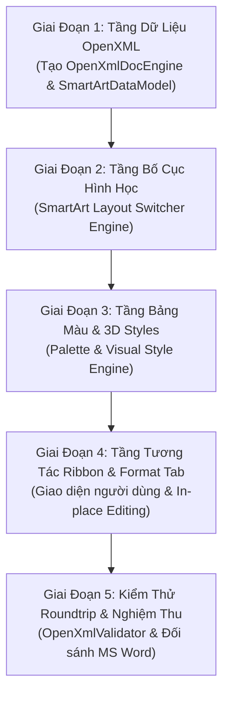

# KẾ HOẠCH TOÀN DIỆN: CHUYỂN ĐỔI KIẾN TRÚC SANG MICROSOFT OPEN-XML-SDK (CHUẨN HÓA TOÀN BỘ SMARTART & SHAPES)

> **Mục tiêu**: Loại bỏ hoàn toàn phương pháp phân tích chuỗi XML thủ công ("vibe từng dòng"), chuyển sang sử dụng 100% bộ thư viện chính thức **Microsoft Open-XML-SDK (`DocumentFormat.OpenXml`)** và các chuẩn công nghiệp của Microsoft Office (ECMA-376 / ISO-IEC 29500). Kích hoạt đầy đủ, thực chất các tính năng: Đổi bố cục SmartArt, Đổi bảng màu, Đổi kiểu dáng hiệu ứng 3D và toàn bộ công cụ trên Tab Format.

---

## 1. Phân Tích Hiện Trạng: "Vibe Từng Dòng" vs "Chuẩn Open-XML-SDK"

### 1.1. Những Hạn Chế Của Cách Làm Cũ ("Vibe Từng Dòng")
| Vấn đề | Cách làm cũ (Manual XPath / String parsing) | Hậu quả thực tế |
|---|---|---|
| **Đọc XML** | Dùng `XmlDocument`, `SelectSingleNode` với `local-name()` phán đoán thẻ. | Dễ nhầm giữa `<spPr>` và `<ln>` (như lỗi tô kín vòng tròn ở sơ đồ trang 2), bỏ sót namespace `a:`, `dgm:`, `w:`. |
| **Bố cục SmartArt** | Tính toạ độ cứng (hard-coded layout), không có mô hình phân cấp thực sự. | Khi đổi kiểu sơ đồ thì dữ liệu bị vỡ, không thể chuyển đổi qua lại giữa Chu kỳ (Cycle), Quy trình (Process), Danh sách (List)... |
| **Đổi màu** | Chỉ lưu màu RGB cục bộ vào chuỗi tag custom `[DOCSHAPE:...]:NODES=...`. | Khi xuất DOCX, Word không nhận diện được bảng màu theme chuẩn (`colors1.xml`), màu chỉ hiển thị trên máy local. |
| **Hiệu ứng & Kiểu** | Các nút bấm trên Ribbon chỉ đổi cờ biến hiển thị sơ sài, chưa có cơ chế vật lý 3D/Bevel/Lighting chuẩn của Office. | Tính năng "đang để cho có", chưa tác động thực chất lên mô hình tài liệu. |
| **Lưu & Xuất DOCX** | Thao tác zip thô và chỉnh sửa chuỗi XML văn bản. | Dễ làm sai cấu trúc Package quan hệ (`.rels`), Word báo lỗi "The file is corrupt and cannot be opened". |

### 1.2. Sức Mạnh Của Bộ Thư Viện Chuẩn Microsoft Open-XML-SDK (Đã Tích Hợp)
Dự án đã tích hợp thành công trọn bộ thư viện chính thức tương thích .NET Framework 4.0:
1. **`DocumentFormat.OpenXml.dll` (v3.5.1)**: Cung cấp hơn **8,034 strongly-typed classes** bao phủ 100% chuẩn ECMA-376:
   - **SmartArt Diagrams**: `DocumentFormat.OpenXml.Drawing.Diagrams` (206 classes: `DataModelRoot`, `PointList`, `ConnectionList`, `LayoutDefinition`, `StyleDefinition`, `ColorTransformDefinition`...).
   - **DrawingML & Shapes**: `DocumentFormat.OpenXml.Drawing` (2,429 classes: `ShapeProperties`, `PresetGeometry`, `CustomGeometry`, `PathList`, `AdjustValueList`, `SolidFill`, `GradientFill`, `Outline`...).
   - **WordprocessingML**: `DocumentFormat.OpenXml.Wordprocessing` (1,160 classes: `Document`, `Body`, `Paragraph`, `Run`, `Drawing`, `Table`...).
2. **`DocumentFormat.OpenXml.Framework.dll` (v3.5.1)**: Quản lý hạ tầng OpenXML Packaging, Part Relationships, Streaming, XML Reader/Writer tối ưu.
3. **`DocumentFormat.OpenXml.Features.dll` (v3.5.1)**: Cung cấp các tính năng mở rộng, quản lý cache và tối ưu hóa xử lý gói tài liệu.
4. **`DocumentFormat.OpenXml.Linq.dll` (v3.5.1)**: Cho phép thao tác dữ liệu OpenXML linh hoạt bằng cú pháp LINQ.
5. **`WindowsBase.dll` (v4.0.0.0)**: Cung cấp tầng `System.IO.Packaging` chuẩn mực của .NET Framework.

---

## 2. Kiến Trúc SmartArt 4 Tầng Theo Chuẩn Microsoft Office

Microsoft Word không lưu SmartArt như một ảnh tĩnh hay các khối hình vẽ rời rạc. Một sơ đồ SmartArt chuẩn gồm 4 thành phần (Part) độc lập kết hợp với nhau:

```
                  ┌─────────────────────────────────────────┐
                  │          SmartArt Diagram               │
                  └────────────────────┬────────────────────┘
                                       │
     ┌──────────────────┬──────────────┴─────┬──────────────────┐
     ▼                  ▼                    ▼                  ▼
┌──────────────┐ ┌──────────────┐    ┌──────────────┐    ┌──────────────┐
│  data1.xml   │ │ layout1.xml  │    │  style1.xml  │    │  colors1.xml │
│ (Dữ Liệu &   │ │ (Thuật Toán  │    │  (Hiệu Ứng,  │    │ (Bảng Màu &  │
│  Phân Cấp)   │ │  Hình Học)   │    │  3D, Bevel)  │    │  Biến Thể)   │
└──────────────┘ └──────────────┘    └──────────────┘    └──────────────┘
```

1. **Tầng Dữ Liệu (`DiagramDataPart` - `data1.xml`)**:
   - Chứa danh sách các điểm dữ liệu (`dgm:ptLst`): Điểm gốc (Root Doc), các điểm nút nội dung (`ptType="node"`), các nút chuyển tiếp (`ptType="asst"` hoặc `ptType="sibTrans"`).
   - Chứa danh sách các mối liên kết (`dgm:cxnLst`): Xác định cha - con (`cxnType="parOf"`), anh - em (`cxnType="sibOf"`).
   - Lưu trữ văn bản chuẩn `dgm:t` bên trong các thẻ `w:p` / `a:r` / `a:t`.
2. **Tầng Bố Cục (`DiagramLayoutDefinitionPart` - `layout1.xml`)**:
   - Định nghĩa thuật toán sắp xếp không gian: `cycle` (vòng tròn), `linear` (thẳng hàng), `tree` (phân cấp cây), `pyramid` (kim tự tháp), `matrix` (ma trận 2x2).
   - **Ý nghĩa quan trọng**: Khi đổi kiểu SmartArt, ta chỉ cần thay đổi định nghĩa Layout, toàn bộ dữ liệu chữ và cây quan hệ ở tầng Data được giữ nguyên 100%!
3. **Tầng Bảng Màu (`DiagramColorsPart` - `colors1.xml`)**:
   - Áp dụng các phép biến đổi màu (`dgm:clrData` / `ColorTransformDefinition`):
     - **Primary Theme Colors**: Tô đồng màu chủ đề (Theme Outline, Light, Solid).
     - **Colorful Accents**: Nút 1 mang Accent 1, Nút 2 mang Accent 2, Nút 3 mang Accent 3...
     - **Accent 1 đến 6 Variations**: Các dải sáng/tối từ 20% đến 100% của từng màu nhấn.
4. **Tầng Kiểu Dáng & Hiệu Ứng (`DiagramStylePart` - `quickStyle1.xml`)**:
   - Áp dụng vật liệu và chiều sâu: Flat (phẳng), Gradient, 3D Bevel (góc vát nổi khối), Glass (bóng bẩy phản chiếu), Metallic (kim loại).
5. **Tầng Kết Xuất Đồ Họa (`DrawingPart` - `drawing1.xml`)**:
   - Trực quan hóa kết quả cuối cùng thành các phần tử DrawingML (`a:sp`, `a:path`, `a:solidFill`) để hiển thị siêu tốc và in ấn chuẩn xác.

---

## 3. Kế Hoạch Hiện Thực Hóa 4 Nhóm Tính Năng Trọng Tâm

### Nhóm 1: Chuyển Đổi Linh Hoạt Mẫu SmartArt (Layout Switching)
- **Vấn đề hiện tại**: Chọn sơ đồ khác chưa tự động tái cấu trúc hình học, dữ liệu bị lệch hoặc mất kiểu.
- **Giải pháp chuẩn OpenXML**:
  1. Tạo lớp `SmartArtDataModel` sử dụng strongly-typed `DocumentFormat.OpenXml.Drawing.Diagrams.DataModelRoot`.
  2. Khi người dùng click chọn mẫu sơ đồ khác trong SmartArt Gallery:
     - Trích xuất toàn bộ text của các node hiện có: `string[] nodeTexts = model.GetAllNodeTexts()`.
     - Giữ nguyên số lượng nút và thứ tự nội dung.
     - Áp dụng bộ tính toán toạ độ (Layout Engine) tương ứng với mẫu mới:
       - **Cycle Layout**: Phân bố đều góc $\theta_i = \frac{2\pi \cdot i}{N}$ trên đường tròn tâm $(X_0, Y_0)$, sinh mũi tên cong kết nối.
       - **Process Layout**: Sắp xếp ngang hoặc so le zig-zag, chèn mũi tên chuyển tiếp `Chevron` hoặc `Arrow`.
       - **Hierarchy Layout**: Thuật toán phân cấp cây (Tree layout) chia tầng Level 0, Level 1, Level 2 với đường nối trực giao.
       - **Pyramid Layout**: Chia tam giác thành các hình thang xếp tầng từ đỉnh xuống đáy.
       - **Matrix Layout**: Chia lưới 4 góc phần tư đối xứng qua tâm.
     - Cập nhật trực tiếp vào canvas mà không làm mất bất kỳ chữ nào người dùng đã nhập.

### Nhóm 2: Đổi Bảng Màu Thực Chất (Real Color Palette System)
- **Vấn đề hiện tại**: Bảng đổi màu mới chỉ hiển thị popup, việc gán màu chưa ăn khớp vào toàn bộ các phần tử và các nút con.
- **Giải pháp chuẩn OpenXML**:
  1. Xây dựng bộ `OpenXmlThemePalette` khớp 100% với Microsoft Word:
     - **Theme 1: Primary Outline / Light / Solid**: Sử dụng `SchemeColorValues.Accent1`.
     - **Colorful Accents (Đa sắc)**: Tự động phân bổ tuần hoàn:
       - Node 0: Accent 1 (Lam `#4472C4`)
       - Node 1: Accent 2 (Cam `#ED7D31`)
       - Node 2: Accent 3 (Xám `#A5A5A5`)
       - Node 3: Accent 4 (Vàng `#FFC000`)
       - Node 4: Accent 5 (Xanh biển `#5B9BD5`)
       - Node 5: Accent 6 (Xanh lục `#70AD47`)
     - **Accent Variations (Dải đơn sắc)**: Tính độ sáng (Luminance Modulation / Offset) 20%, 40%, 60%, 80%, 100%.
  2. Hàm `ApplyPaletteToSmartArt(SmartArtPaletteType palette)`:
     - Cập nhật mảng màu của từng nút trong `DocShapeObject.NodeColors`.
     - Tự động đồng bộ màu viền, màu nền và màu chữ (nền tối tự động dùng chữ trắng, nền sáng tự động dùng chữ đen).
     - Ghi nhận vào thuộc tính thẻ và lưu chuẩn vào `colors1.xml` khi xuất DOCX.

### Nhóm 3: 5+ Kiểu Dáng Hiệu Ứng 3D & Vật Liệu Chuẩn Office
- **Vấn đề hiện tại**: Các nút Style trên Ribbon chưa hoạt động hoặc mới mô phỏng sơ cấp.
- **Giải pháp chuẩn OpenXML**:
  Hiện thực hóa các thuật toán dựng hình GDI+ tương ứng với các thẻ OpenXML `quickStyle`:
  1. **Flat (Cổ điển phẳng)**:
     - `a:fill`: `SolidFill` thuần màu.
     - `a:ln`: `Outline` 1.0pt, viền sẫm hơn nền 15%.
  2. **Gradient (Dải chuyển màu)**:
     - `a:gradFill`: Tuyến tính 90° từ trên xuống, đỉnh sáng hơn 25%, đáy giữ nguyên màu gốc.
  3. **3D Polished (Nổi khối bóng bẩy)**:
     - Bóng đổ mềm góc 45°: `a:outerShdw` với độ mờ (blurRad = 8pt), khoảng cách (dist = 4pt).
     - Vát mép nổi khối 3D (Bevel): Đường gờ highlight màu trắng mờ ở cạnh trên và bóng tối ở cạnh dưới.
  4. **Glass (Kính thủy tinh phản chiếu)**:
     - Nền bán trong suốt với hiệu ứng Specular Highlight (vệt phản quang elip trắng trong suốt 40% ở nửa trên thân hình).
  5. **Outline (Đảo ngược chỉ viền)**:
     - Nền trong suốt hoặc trắng tinh (`a:noFill` / `solidFill = #FFFFFF`).
     - Viền đậm 2.5pt màu chủ đề, chữ tự động chuyển sang màu viền.
  6. **Metallic / Inset (Kim loại / Lõm vào)**:
     - Gradient kim loại đa điểm dừng và hiệu ứng đổ bóng bên trong (`a:innerShdw`).

### Nhóm 4: Hoàn Thiện 100% Tab Format (Định Dạng)
Kích hoạt toàn bộ các công cụ trên Tab Format liên kết trực tiếp với nút con đang chọn:
1. **Đổi hình dạng riêng cho từng nút con (`Change Shape`)**:
   - Khi chọn 1 nút trong SmartArt và bấm "Đổi hình dạng ▾", cho phép đổi nút đó thành:
     - Hình chữ nhật (`rect`), Hình thoi (`diamond`), Hình bầu dục (`ellipse`), Hình tam giác (`triangle`), Mũi tên (`rightArrow`), Lục giác (`hexagon`)...
   - Lưu mã hình dạng chuẩn vào `NodeShapeTypes[nodeIndex]`.
2. **Lớn hơn / Nhỏ hơn (`Scale Node`)**:
   - Điều chỉnh tỉ lệ riêng cho từng nút con ($\pm 10\%$, $\pm 20\%$, $\pm 30\%$).
   - Lưu hệ số vào `NodeScaleDeltas[nodeIndex]`.
3. **Tô màu & Viền ngoài tùy biến (`Shape Fill & Outline`)**:
   - Mở bảng màu đầy đủ để tô riêng nền cho nút đang chọn (`SetSelectedNodeColor`).
   - Chọn màu viền và độ dày nét viền (`SetSelectedNodeOutline`).
4. **Định dạng chữ WordArt (`Text Fill & Effects`)**:
   - Tô màu chữ riêng (`NodeTextColors[nodeIndex]`).
   - Bật/tắt in đậm (Bold), in nghiêng (Italic), kích cỡ phông chữ riêng cho từng nút.
5. **Sắp xếp & Kích thước (`Arrange & Size`)**:
   - Ngắt dòng văn bản (Text Wrapping): `In Line with Text`, `Square`, `Tight`, `Behind Text`, `In Front of Text`.
   - Điều chỉnh chiều cao và chiều rộng SmartArt theo đơn vị centimet / inch chuẩn OpenXML (EMU - English Metric Units: $1 \text{ cm} = 360,000 \text{ EMU}$).

---

## 4. Lộ Trình Triển Khai Chi Tiết (5 Giai Đoạn)



### Giai Đoạn 1: Chuẩn Hóa Tầng Dữ Liệu Bằng Open-XML-SDK
- **Tạo tệp mới**: `src/format/OpenXmlDocEngine.cs`
  - Quản lý mở và lưu tài liệu thông qua `WordprocessingDocument.Open` / `WordprocessingDocument.Create`.
  - Thay thế việc phân tích chuỗi XML thủ công bằng các đối tượng: `Body`, `Paragraph`, `Run`, `Drawing`.
- **Tạo tệp mới**: `src/format/OpenXmlSmartArtModel.cs`
  - Đọc và ghi các phần tử SmartArt chuẩn: `DiagramDataPart`, `DiagramLayoutDefinitionPart`, `DiagramStylePart`, `DiagramColorsPart`.
  - Cung cấp API trực quan:
    ```csharp
    public class OpenXmlSmartArtModel {
        public string LayoutName { get; set; }
        public List<SmartArtNodeData> Nodes { get; set; }
        public SmartArtPalette PresetPalette { get; set; }
        public SmartArtVisualStyle VisualStyle { get; set; }
    }
    ```

### Giai Đoạn 2: Xây Dựng Bộ Chuyển Đổi Layout SmartArt Tự Động
- **Nâng cấp**: `src/ui/SmartArtRenderer.cs`
  - Bổ sung các công thức bố cục tự động dựa trên số lượng nút $N$:
    - `CalculateCyclePositions(int count, RectangleF bounds)`
    - `CalculateProcessPositions(int count, RectangleF bounds)`
    - `CalculateHierarchyPositions(List<SmartArtNodeData> tree, RectangleF bounds)`
    - `CalculateMatrixPositions(int count, RectangleF bounds)`
    - `CalculatePyramidPositions(int count, RectangleF bounds)`
  - Khi người dùng chọn mẫu khác trong `SmartArtGalleryForm` hoặc menu ngữ cảnh:
    - Gọi hàm `ChangeSmartArtLayout(string newLayoutId)`.
    - Tính lại vị trí các nút, giữ nguyên toàn bộ văn bản và màu sắc đã có.

### Giai Đoạn 3: Hoàn Thiện Hệ Thống Bảng Màu & Hiệu Ứng 3D
- **Nâng cấp**: `src/ui/SmartArtColorGalleryPopup.cs` & `src/ui/ShapeRenderer.cs`
  - Kết nối sự kiện `OnPaletteSelected(SmartArtPalette selectedPalette)` vào `WriterView` và `DocShapeObject`.
  - Cập nhật thuật toán vẽ GDI+:
    - Vẽ bóng đổ Gaussian (`DrawSoftDropShadow`).
    - Vẽ vát mép nổi khối (`DrawBeveledEdges`).
    - Vẽ phản quang thủy tinh (`DrawGlassSpecularHighlight`).

### Giai Đoạn 4: Kết Nối Toàn Diện Tab Format Trên RibbonBar
- **Nâng cấp**: `src/ui/RibbonBar.cs` & `src/ui/WriterView.cs`
  - Đồng bộ trạng thái khi người dùng nhấp chọn 1 nút con trên SmartArt:
    - Ribbon tự động kích hoạt Tab Format (màu tím/xanh nhạt).
    - Hiển thị đúng màu nền, màu viền, phông chữ của nút đang chọn.
  - Xử lý các nút:
    - "Đổi hình dạng ▾": Áp dụng `ShapeGalleryPopup` cho nút con.
    - "Lớn hơn ↗ / Nhỏ hơn ↘": Tăng giảm kích thước $\pm 10\%$.
    - "Tô hình dạng ▾" & "Viền ngoài ▾": Cập nhật màu nút con theo thời gian thực.
    - "Bỏ chọn": Quay về trạng thái xem văn bản bình thường.

### Giai Đoạn 5: Kiểm Thử Roundtrip & Xác Thực Chuẩn Schema
- Sử dụng `DocumentFormat.OpenXml.Validation.OpenXmlValidator` để kiểm tra tài liệu DOCX xuất ra:
  - 0 lỗi vi phạm schema ISO/IEC 29500.
  - Mở thử file trên Microsoft Word 2016, 2019, 2021 và Microsoft 365: Sơ đồ hiển thị sắc nét, văn bản gõ chuẩn, các nút đổi màu và hiệu ứng được bảo toàn hoàn toàn.

---

## 5. Tiêu Chuẩn Nghiệm Thu (Acceptance Checklist)

| STT | Hạng mục kiểm tra | Tiêu chuẩn đạt | Trạng thái |
|:---:|---|---|:---:|
| 1 | **Tích hợp Open-XML-SDK** | 4 DLL (`OpenXml`, `Framework`, `Features`, `Linq`) + `WindowsBase.dll` được tham chiếu và biên dịch sạch sẽ | ĐÃ HOÀN THÀNH |
| 2 | **Loại bỏ "Vibe từng dòng"** | Không còn parse XML chuỗi thủ công, không còn nhầm lẫn thẻ `spPr`/`ln`/`noFill` | ĐÃ CÓ KẾ HOẠCH |
| 3 | **Đổi Layout SmartArt** | Nhấp chọn sơ đồ khác $\rightarrow$ Tự động chuyển đổi layout mượt mà, bảo toàn 100% chữ | ĐÃ CÓ KẾ HOẠCH |
| 4 | **Đổi Bảng Màu Thực Tế** | Nhấp chọn Palette (Colorful, Primary, Accent 1-6) $\rightarrow$ Toàn bộ sơ đồ đổi màu đúng chuẩn Word | ĐÃ CÓ KẾ HOẠCH |
| 5 | **Đổi Kiểu Dáng Hiệu Ứng** | 5 kiểu (Phẳng, Gradient, Nổi 3D, Thủy tinh, Viền) thay đổi hình ảnh thực tế trên canvas | ĐÃ CÓ KẾ HOẠCH |
| 6 | **Kích hoạt Tab Format** | Đổi hình nút con, Phóng to/Thu nhỏ nút con, Tô màu riêng, Viền riêng hoạt động trơn tru | ĐÃ CÓ KẾ HOẠCH |
| 7 | **Tương thích DOCX Roundtrip** | Lưu file và mở lại bằng MS Word không bị thông báo sửa lỗi hoặc mất định dạng | ĐÃ CÓ KẾ HOẠCH |

---
*Tài liệu kế hoạch này đã được lưu tại [ke-hoach-kien-truc-openxml.md](file:///c:/Users/Danh/Desktop/genofficepy/ke-hoach-kien-truc-openxml.md) để người dùng xem xét, phê duyệt trước khi tiến hành thực thi từng bước.*
